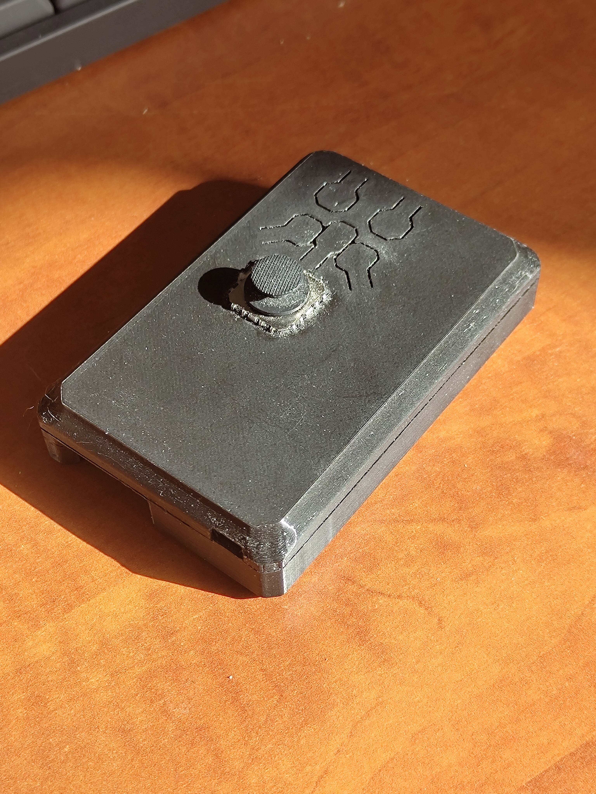
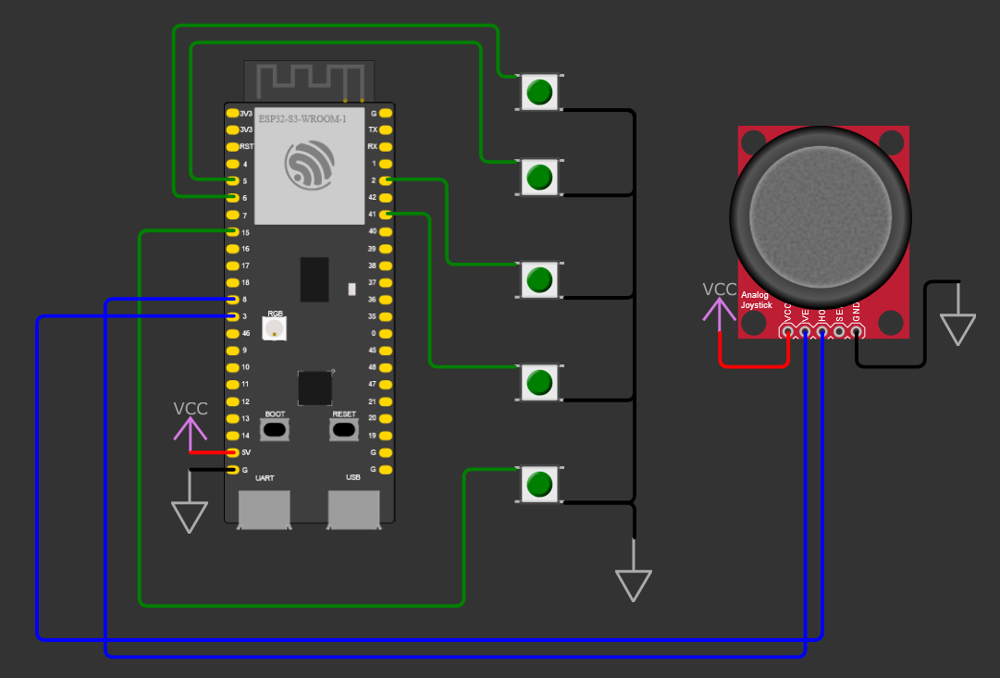

# [ESP BLE REMOTE]

A remote control for simulating an HID device: sends media key presses (Pause/Play, Volume+/-), as well as data on joystick movements and mouse button clicks (L_MOUSE, R_MOUSE). The remote control uses a built-in WS2812 to display the status

##  Schematic 

## HW
- **Dev board:** ESP32-S3-CAM (GOOUUU)
- **Periphery:** 5x standard 6x6mm buttons, standard analog joystick
- **Power:** 5v powerbank internals (MP3401A, 18650 3.7V li-ion cell)

## Firmware & Build
- **Framework:** ESP-IDF v6.0
- **Stack:** NimBLE-HID,  ESP-BLE-HID